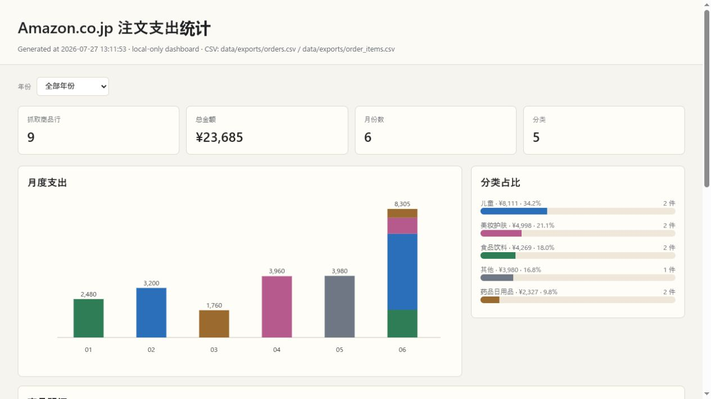

# Amazon JP Orders Dashboard

[日本語](README.md)

[](https://github.com/HanaCROOK/amazon-jp-orders-dashboard/actions/workflows/ci.yml)
[](https://github.com/HanaCROOK/amazon-jp-orders-dashboard/releases/latest)
[](LICENSE)
[](https://www.python.org/)

**Turn your signed-in Amazon.co.jp order history into a private, local spending dashboard.**

One-click incremental sync, item-level expense categories, monthly charts, and
CSV export. No cloud account, no Amazon credentials, and no telemetry.



> Order history never leaves your computer. The project does not store Amazon passwords or cookies.

## Start in three steps

1. Extract the ZIP from the [latest release](https://github.com/HanaCROOK/amazon-jp-orders-dashboard/releases/latest).
2. Double-click `start_dashboard.bat`.
3. Open `chrome://extensions/` and load the included `chrome_extension` folder.

See the [Japanese installation guide](docs/INSTALL.md) for update, removal, and troubleshooting details.

## Highlights

- **One-click latest sync**: resumes near the newest local order and overlaps 14 days to refresh recent changes.
- **Real item details**: reads order-detail pages for multi-item orders instead of assigning the whole total to one title.
- **Local-first**: order data stays under `data/` on your computer.
- **No credentials**: reuses your signed-in Chrome session; passwords, OTPs, and cookies are never stored.
- **Useful outputs**: SQLite, UTF-8 CSV, JSON snapshots, and a local HTML dashboard.
- **Editable categories**: manual corrections are remembered for matching product titles.
- **Auditable automation**: visible progress, deliberately slow page navigation, and no purchase or account actions.
- **Small stack**: Python standard library, vanilla JavaScript, SQLite, and a Manifest V3 extension.

## Quick start

Requirements: Windows, Python 3.10+, Google Chrome, and an Amazon.co.jp account
already signed in to Chrome.

1. Clone or download this repository.
2. Run `start_dashboard.bat`.
3. Open `chrome://extensions/`, enable **Developer mode**, choose **Load unpacked**, and select `chrome_extension`.
4. Open the extension and choose **最新の注文を同期**.
5. Keep the sync tab open. The dashboard opens automatically when the sync finishes.

On macOS or Linux, start the receiver with:

```bash
python run.py serve --host 127.0.0.1 --port 8776
```

## Sync modes

| Mode | Use it for | Behavior |
|---|---|---|
| Latest-order sync | Routine updates | Current year, latest local order minus 14 days through today |
| Date-range capture | Backfilling or repairing history | Selected year and explicit start/end dates |
| Current-page capture | Parser checks | Reads only the visible order-history page |

The overlap is intentional. SQLite upserts by order ID and item key, so recent
orders can be refreshed without double-counting spending.

## Data and privacy

Order data is stored under the ignored local `data/` directory as SQLite, JSON
snapshots, CSV exports, and a generated dashboard. Never attach that directory,
real order screenshots, names, addresses, credentials, or cookies to an issue.
See [PRIVACY.md](PRIVACY.md) and [SECURITY.md](SECURITY.md).

The receiver accepts loopback connections only, rejects untrusted browser
origins, requires JSON for writes, and applies restrictive security headers.
The extension is limited to Amazon.co.jp and the local receiver.

### Extension permissions

| Permission | Purpose |
|---|---|
| `scripting` | Run the packaged parser after a user presses a capture button |
| `https://www.amazon.co.jp/*` | Read order-history and order-detail pages |
| `http://127.0.0.1:8776/*` | Save to the receiver on the same computer |

The extension does not request tabs, cookies, downloads, payment, general history, or remote-code permissions.

## Categories

- Food & drink (`食品・飲料`)
- Children's items (`子ども用品`)
- Beauty & skincare (`美容・スキンケア`)
- Medicine & daily necessities (`医薬品・日用品`)
- Other (`その他`)

Keyword rules live in `config/category_rules.json`. Categories can also be
corrected directly in the item table and remembered for identical product names.

## Architecture

```text
Signed-in Chrome
  └─ Manifest V3 extension (read-only Amazon pages)
       └─ JSON → http://127.0.0.1:8776
            └─ Python receiver
                 ├─ SQLite + snapshots + CSV
                 └─ local dashboard
```

The tool never clicks buy, cancel, return, exchange, payment, or account-setting
controls. Login challenges and CAPTCHA require manual handling.

## Development

```text
python -m pip install pytest
python -m pytest
node --check chrome_extension/popup.js
node --check chrome_extension/batch.js
node --check chrome_extension/capture_core.js
python scripts/check_public_release.py
python scripts/build_release.py
```

The repository ships synthetic fixtures only. Contributions that change Amazon
DOM parsing must not include real account screenshots or order IDs. See
[CONTRIBUTING.md](CONTRIBUTING.md).

Use [Issues](https://github.com/HanaCROOK/amazon-jp-orders-dashboard/issues) for focused bug reports and proposals.
See [ROADMAP.md](ROADMAP.md) and [SUPPORT.md](SUPPORT.md) for project direction and support boundaries.

## Limitations

- Amazon can change its page structure without notice.
- The parser targets Amazon.co.jp's Japanese order-history experience.
- Item prices may be unavailable for some promotions, refunds, digital orders, or unusual fulfillment layouts.
- This is a personal spending aid, not accounting, tax, or financial advice.

## License

MIT. This independent project is not affiliated with or endorsed by Amazon.
